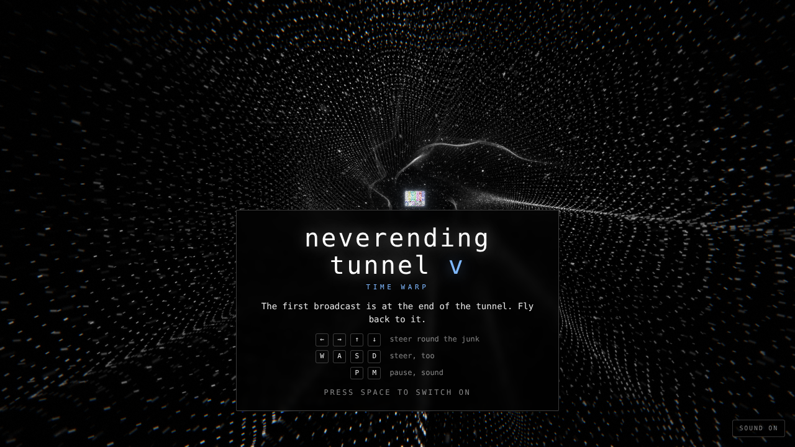
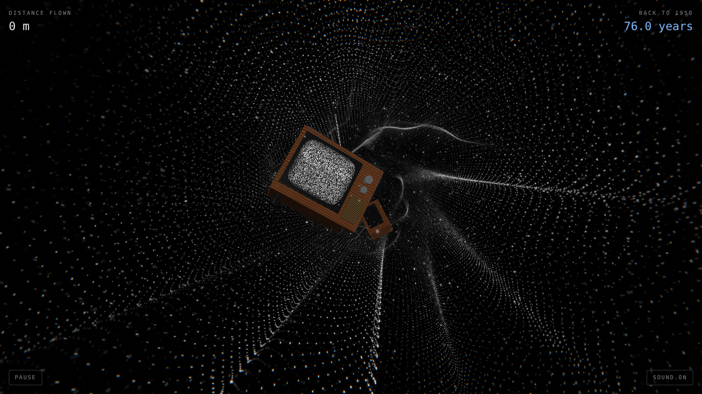
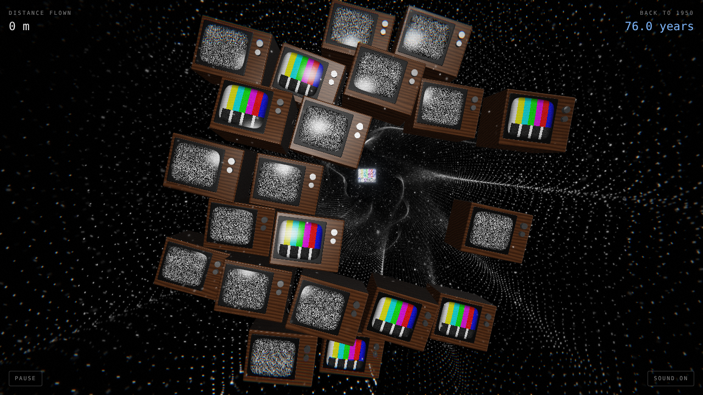
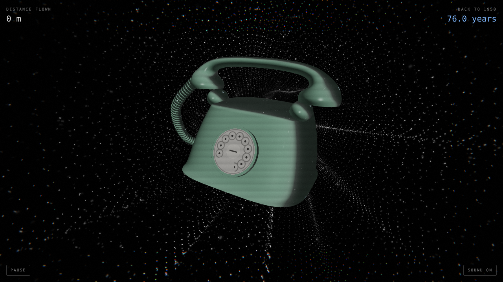
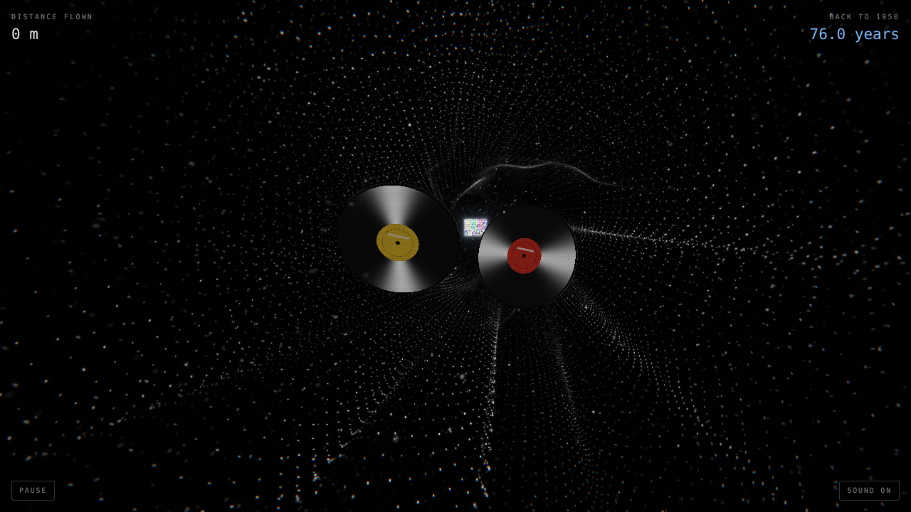
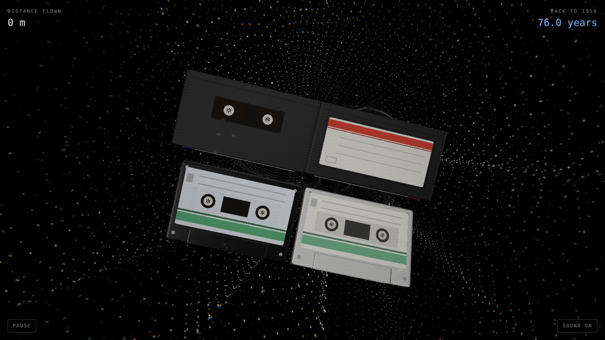
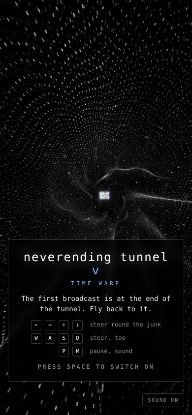

# Neverending Tunnel V: Time Warp

Fly back down an endless tunnel of TV static, round the old TV sets,
tapes, records and telephones tumbling through it, towards the first
broadcast. It's at the end of the tunnel. You never reach it.

The tunnel is static now: sheets of flickering dots, one inside another,
draped into folds that drift and roll, with bright creases where the dots
bunch up and a dark hole at the far end. Now and then a bar rolls down it,
like a set losing its vertical hold. In the hole, the test card glows, the
only colour there is, coming in clearer the further back you get. It's all
on an old set: scanlines, a little colour fringing, the picture slipping
when something goes by close, and when you crash the set switches off,
the picture squeezed into a bright line and then gone. Like Neverending
Tunnel II, III and IV it's drawn with WebGPU where the browser has it and
WebGL 2 where it doesn't, with the same shaders written for each (WGSL in
`src/shaders`, GLSL in `src/shaders/gl`).



| | |
|---|---|
|  |  |
| A TV set | A wall of TVs, with a gap |
|  |  |
| A rotary telephone | Records |
|  |  |
| VHS tapes and cassettes | On a phone |

## Run

```sh
npm install
npm run dev      # http://localhost:5173
npm run build    # static build in dist/
```

The build is plain static files (relative paths), so any static host
can serve `dist/` as it is. On Vercel, the Vite preset's defaults (`npm run build`,
output `dist`) are all it needs.

Needs WebGPU or WebGL 2 (any current browser). `?renderer=webgl` or
`?renderer=webgpu` pins one, and `?particles=60000` sets how many dots the
static has (it otherwise starts at 140,000, or 60,000 on phones, and thins
itself out if frames run slow).

## Controls

- ← → ↑ ↓ / W A S D: steer
- Drag: steer, on a phone
- Space / tap: switch on, switch back on
- P: pause, M: sound

## The junk

- Wooden TV sets with rabbit ears, the picture tube showing snow or colour bars
- Walls of TV sets right across the tunnel, with one way through
- VHS tapes tumbling: the smoked window over the reels, a sticker on the back, a label on the spine
- Records skimming across the tunnel, spinning, the light streaking across their grooves
- Rotary telephones: the finger wheel over the number card, the handset in its cradle, the coiled cord. They ring as you come up on them, and the handset rattles. Don't answer it
- Cassettes, in clusters: labels, hubs, screws

Passing close is a near miss: you'll hear it go by, and the picture slips.
The counter in the corner is how many years back it is to 1950; it halves
every 250 metres.

## Sound

All made as it plays, with Web Audio, no samples. The drone is a Shepard
tone: it rises for ever and never gets any higher, played as if off a worn
tape, wavering with wow and flutter. Under it: the hiss of static, louder
the faster you fly, the hum of the mains, the thin whine of a picture tube
high up, and the crackle of a record. Telephones ring as you come up on
them, a clapper between two gongs; things going by close sound like the
dial being turned through the static. Switching on is the thunk of the
switch and the tube whining up; crashing switches the set off, with the
whine falling away, and glass, a bell or a needle skidding, depending on
what you hit. Every milestone, the test tone.

## Layout

- `src/shaders/particles.wgsl`: the tunnel's sheets of static and the snow in it, every dot made up from its index
- `src/shaders/things.wgsl`: TV sets, tapes, records, telephones and cassettes: what each part is made of, and the light on them and in their finishes
- `src/shaders/card.wgsl`: the test card at the end
- `src/shaders/post.wgsl`: the old set: tone mapping, fringing, scanlines, grain, the picture slipping, switching off
- `src/shaders/gl/`: the same four for WebGL 2
- `src/gpu.js`, `src/gl.js`: the WebGPU and WebGL 2 renderers (multisampled); `src/renderer.js` picks one
- `src/frame.js`: packs each frame's uniforms once for either renderer
- `src/game.js`: flying, steering, the junk, collisions, near misses and the set switching off
- `src/meshes.js`: rounded boxes, the picture tube's glass, a cylinder, a ball, the telephone's lofted body, its handset and coiled cord
- `src/main.js`: the frame loop
- `src/input.js`, `src/hud.js`, `src/sound.js`: controls, HUD, audio
- `src/constants.js`, `src/math.js`: shared numbers and helpers
